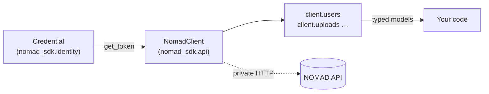
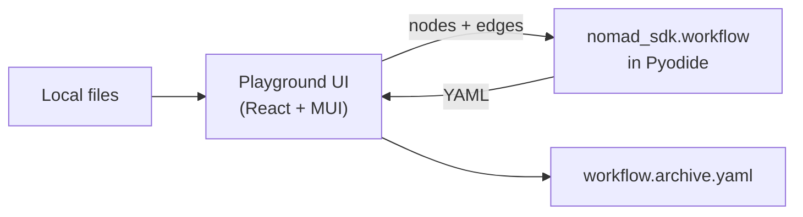
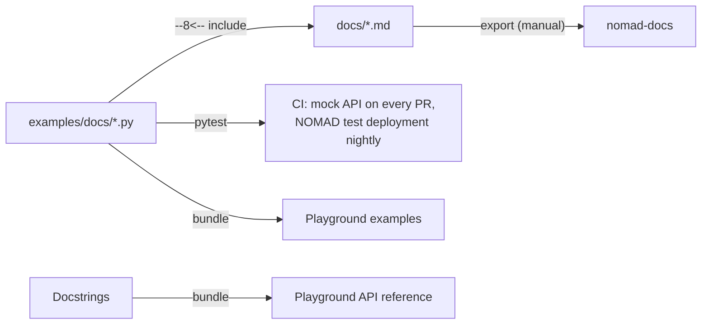

# nomad-sdk

Python SDK for the [NOMAD](https://nomad-lab.eu) platform, and the successor of
[`nomad-utility-workflows`](https://github.com/FAIRmat-NFDI/nomad-utility-workflows).

| Import | What it is |
| --- | --- |
| `nomad_sdk.api` | Python client for NOMAD: `NomadClient`, operations grouped by resource (`client.users`), typed results |
| `nomad_sdk.identity` | Credentials: `PersonalAccessTokenCredential`, `UsernamePasswordCredential`, `EnvironmentCredential` |
| `nomad_sdk.workflow` | Build custom-workflow archives (`workflow.archive.yaml`) |
| `nomad_sdk.playground` | Browser playground: workflow designer and API reference |

## Install

```bash
pip install git+https://github.com/FAIRmat-NFDI/nomad-sdk
```

## Quick start

```python
from nomad_sdk import NomadClient
from nomad_sdk.identity import PersonalAccessTokenCredential

client = NomadClient('test', PersonalAccessTokenCredential('<your PAT>'))
print(client.users.get_me().name)
```

Or configure it from the environment (`NOMAD_API_URL`, `NOMAD_PAT`):

```python
from nomad_sdk import NomadClient

client = NomadClient.from_env()
```

The client wraps NOMAD's REST API, in the style of `boto3` or the Azure SDKs: you work
with a client, credentials and typed results, not with URLs or HTTP requests.



## Command line

```bash
nomad-sdk whoami                # account for NOMAD_API_URL + NOMAD_PAT
nomad-sdk playground serve      # run the playground locally
```

## Playground

The playground runs entirely in the browser. Python (the `nomad_sdk` engine) runs
through Pyodide (WebAssembly), and your files never leave your computer.

* **Workflow designer** (`/workflow`): open a folder, add steps from its mainfiles,
  connect them, and download `workflow.archive.yaml`.
* **API Explorer** (`/api`): the Python API reference, generated from the docstrings.

It is published on GitHub Pages and ships in the package (`nomad-sdk playground serve`).



The UI only collects input and shows results; all workflow logic lives in
`nomad_sdk.workflow`.

## Docs, examples and CI

This repository holds the NOMAD documentation pages about workflows and the SDK, at the
same paths as in [nomad-docs](https://github.com/FAIRmat-NFDI/nomad-docs). Every Python
example on those pages is a file in `examples/docs/`. The same file is shown in the docs
and run by CI, so the docs cannot drift from the code.



* `docs-sync.yaml` lists the pages: `owned` pages are edited here, while `mirror` pages
  are read-only copies from nomad-docs.
* Export owned pages to nomad-docs by hand:
  `python scripts/docs_sync.py export --target ../nomad-docs`.

## Development

```bash
uv venv && uv pip install -e ".[dev,docs]"
pytest                                            # tests + docs examples (offline)
NOMAD_SDK_LIVE=1 NOMAD_API_URL=test NOMAD_PAT=... pytest   # against NOMAD
mkdocs serve                                      # preview the docs
python -m nomad_sdk.playground.bundle --update    # after editing examples or docstrings
```

```bash
cd playground && npm ci
npm run dev                                       # http://localhost:5173/workflow
npm run lint && npm run typecheck && npm test
```

## Repository layout

```text
src/nomad_sdk/       the package (api, identity, workflow, playground, cli)
playground/          playground UI (React + MUI + Vite)
docs/                NOMAD docs pages about workflows and the SDK
examples/docs/       example files shown in the docs and run by CI
tests/               unit, golden-output, docs-example and playground tests
.github/workflows/   ci, docs, docs-live, playground (Pages), release
```

## Migrating from nomad-utility-workflows

| nomad-utility-workflows | nomad-sdk |
| --- | --- |
| `from nomad_utility_workflows.utils.workflows import ...` | `from nomad_sdk.workflow import ...` (same names, same output) |
| `utils.core.get_authentication_token()` | `nomad_sdk.identity` credentials |
| `utils.users.who_am_i()` | `client.users.get_me()` |
| `url=None` falls back to the test deployment | the deployment is always explicit (URL or `central` / `test` / `develop`) |